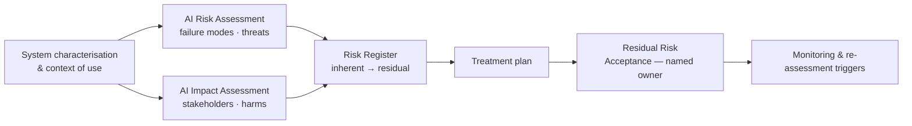

# AI Risk Assessment & AI Impact Assessment


### Union Grid Energy — Assessing a safety-critical AI system two different ways, for two different audiences

   -1f2a44) 

> **Short description:** A paired assessment of **GridSense**, an AI system that forecasts grid load and automatically dispatches demand-response events. The **risk assessment** asks *what could go wrong with the system* (18 risks, likelihood × impact, treatment). The **impact assessment** asks *who is affected and how* (7 stakeholder groups, 6 harm categories, including medically vulnerable customers). A residual-risk acceptance record closes the loop with a named accountable executive.

---

## 1. Organisation & System Context

| Attribute | Detail |
|---|---|
| Organisation | Union Grid Energy (fictional) — investor-owned electric utility |
| Customers | ~1.9m (1.68m residential, 210k commercial & industrial) |
| Regulation | State Public Utility Commission; NERC Reliability Standards incl. CIP; regional ISO/RTO market rules |
| System assessed | **GridSense** — ML load-forecasting (15-min to 7-day horizons) + Demand-Response Automation (DRA) module that issues curtailment signals to enrolled smart thermostats, water heaters, EV chargers and C&I loads via aggregator APIs |
| Autonomy | Day-ahead DR events: operator-approved. Real-time events (< 30 min): **automatically dispatched** within a pre-approved envelope |
| Why it matters | Failure modes are **physical**: under-forecasting can lead to emergency load shedding; over-aggressive curtailment can disable cooling for vulnerable customers during heatwaves |

## 2. Objective

Demonstrate the distinction most portfolios blur:

| | AI Risk Assessment | AI Impact Assessment |
|---|---|---|
| **Central question** | What could go wrong with the system, how likely, how bad? | Who is affected, how, and is that fair and acceptable? |
| **Unit of analysis** | Failure modes, threats, control weaknesses | Stakeholders and categories of harm (and benefit) |
| **Primary audience** | System owner, control room leadership, risk & cyber functions | Executive leadership, regulators (PUC), customer advocates, ethics/sustainability |
| **Method** | Likelihood × impact scoring, control evaluation, treatment plan | Stakeholder mapping, harm analysis, distributional analysis, mitigation & redress |
| **Output** | Risk register, treatment plan | Impact statement, commitments, monitoring of affected outcomes |

## 3. Scope

**In scope:** GridSense forecasting models, the DRA module, input data pipelines (SCADA, AMI, weather feeds, DER telemetry), aggregator integrations, operator interface, and the human-oversight procedures in the System Operations Control Centre.

**Out of scope:** Market bidding strategy; generation dispatch outside DR; aggregator internal systems (assessed only at the interface).

## 4. Approach



Workshops: 6 (control-room operators, data science, OT security, customer programmes, regulatory affairs, customer-advocacy liaison). Data reviewed: 3 years of forecast error, 2 summers of DR event logs, outage records, enrolment demographics by census tract.

## 5. Deliverables

| # | Deliverable | Audience |
|---|---|---|
| 1 | [AI-Risk-Assessment.md](AI-Risk-Assessment.md) | System owner, Operations, Enterprise Risk, OT Security |
| 2 | [AI-Impact-Assessment.md](AI-Impact-Assessment.md) | Executive Committee, PUC, customer advocates |
| 3 | [Risk-Register.md](Risk-Register.md) | Risk owners — operational tracking |
| 4 | [Residual-Risk-Acceptance.md](Residual-Risk-Acceptance.md) | Accountable executive, Enterprise Risk Committee |

## 6. Headline Results

| Metric | Result |
|---|---|
| Risks identified | 18 |
| Inherent Critical / High | 4 / 8 |
| Residual Critical / High (after treatment) | 0 / 3 |
| Impact assessment: stakeholder groups | 7 |
| Most significant impact finding | Real-time DR events were dispatched **2.3× more often** in tracts with older housing stock (higher thermal loss), concentrating discomfort on lower-income households |
| Key treatment | Medical-baseline customers excluded from automated events; per-premise event caps; equity monitoring metric added |
| Residual risk accepted by | VP System Operations (named), with 12-month review |

## 7. Framework Alignment

| Framework | Reference | Where |
|---|---|---|
| NIST AI RMF 1.0 | MAP 1–5 (context, categorisation, impacts) | Both assessments §2–3 |
| NIST AI RMF 1.0 | MEASURE 1–4 (metrics, safety 2.6, fairness 2.11, monitoring 2.4) | Risk Assessment §5–6 |
| NIST AI RMF 1.0 | MANAGE 1.2–1.4, 2.4 | Treatment; residual risk; disengagement |
| EU AI Act (structural reference) | Art. 9 risk management system; Annex III(2) critical infrastructure | Lifecycle risk process mirrors Art. 9(2) steps |
| ISO/IEC 42001 | 6.1.2, 6.1.3, 6.1.4 / 8.2–8.4 | Risk assessment, treatment, impact assessment |
| ISO/IEC 23894 | AI risk management guidance | Risk identification taxonomy |
| NERC CIP | CIP-005, CIP-007, CIP-013 | OT cyber controls in treatment plan |

## 8. Repository Structure

```
union-grid-ai-risk-impact-assessment/
├── README.md
├── assets/banner.jpg
├── AI-Risk-Assessment.md
├── AI-Impact-Assessment.md
├── Risk-Register.md
└── Residual-Risk-Acceptance.md
```

## 9. Skills Demonstrated

AI risk assessment (5×5, control evaluation, treatment) · AI impact assessment & distributional analysis · Safety-critical / OT context · Human-oversight design · Cyber-physical threat modelling · Risk acceptance governance · Regulatory communication

## 10. Disclaimer

Union Grid Energy and GridSense are fictional. Figures are illustrative.

---

